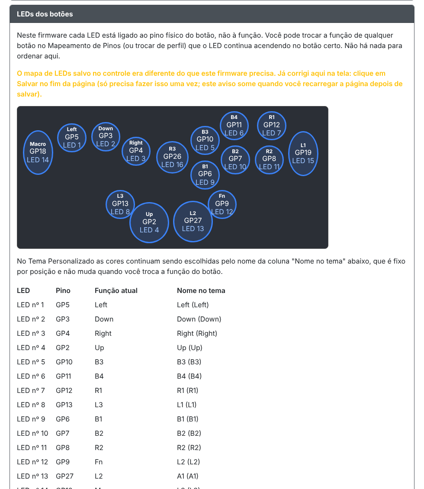

# firmware-c16s-ledporpino

Firmware alternativa para a Haute42 C16S (placa COSMOX M Ultra, RP2040) em que os LEDs dos botões já vêm configurados por pino da placa e não mudam quando você muda a função dos botões.

É o [GP2040-CE v0.7.12](https://github.com/OpenStickCommunity/GP2040-CE/releases/tag/v0.7.12) oficial da `Haute42COSMOXMUltra` com um patch pequeno aplicado direto no binário. Não é um projeto oficial do GP2040-CE nem da Haute42.



## O que muda

No firmware original, cada LED acende quando a **função** dele é pressionada (B1, L3, etc.). Se você remapeia um botão, o LED deixa de acompanhar, e botões com função fora do gamepad (Fn, Macro, Turbo) nunca acendem LED.

Neste firmware, cada LED acende quando o **botão físico** dele é pressionado:

- Trocar a função de um botão ou trocar de perfil não afeta os LEDs.
- Fn, Macro e qualquer outra função acendem o próprio LED.
- START, BACK, HOME, – e T continuam sem LED (não têm LED na placa).

Ordem dos LEDs na fita, por pino:

| LED | Pino | LED | Pino |
|---|---|---|---|
| 1 | GP5 | 9 | GP6 |
| 2 | GP3 | 10 | GP7 |
| 3 | GP4 | 11 | GP8 |
| 4 | GP2 | 12 | GP9 |
| 5 | GP10 | 13 | GP27 |
| 6 | GP11 | 14 | GP18 |
| 7 | GP12 | 15 | GP19 |
| 8 | GP13 | 16 | GP26 |

## Como instalar

1. Na interface web atual do controle, faça o backup da sua configuração.
2. Coloque o controle em modo BOOTSEL e copie para ele o arquivo [`firmware/GP2040-CE_0.7.12_Haute42COSMOXMUltra_LedPorPino.uf2`](firmware/GP2040-CE_0.7.12_Haute42COSMOXMUltra_LedPorPino.uf2).
3. Abra a interface web, vá em Configuração → Configuração de LED. Se aparecer o aviso amarelo dizendo que o mapa de LEDs foi corrigido, clique em **Salvar** no fim da página. Só é preciso fazer isso uma vez.

Para voltar atrás, grave de novo o UF2 oficial do GP2040-CE pelo BOOTSEL.

## Limitações

- A ordem da fita está fixa no código para esta placa. Não serve para outras placas.
- Não dá para reordenar os LEDs nem desligar o LED de um botão específico.
- No Tema Personalizado, as cores são escolhidas pelo nome de fábrica de cada posição, não pela função atual do botão. A tabela "Nome no tema" na tela de LED mostra a correspondência.
- O LED mostra o toque físico, mesmo quando o SOCD cancela a direção.
- Um botão sem nenhuma função no mapeamento de pinos não acende ao toque.
- O trecho de código alterado foi validado por emulação (`tools/test_emulate.py`). Use por sua conta e risco.

## Como o patch funciona

- **Código de LED.** Em `NeoPicoLEDAddon::process`, o cálculo de `buttonState` (8 bytes em `0x1005DB20`) é desviado para um bloco novo no fim da imagem. O bloco lê os 16 pinos direto das portas e monta o mesmo valor a partir dos botões físicos. O código-fonte está em [`tools/led_hook.S`](tools/led_hook.S).
- **Interface web.** A seção de ordem dos LEDs em `/led-config` é trocada pelo componente de [`tools/led_ui.js`](tools/led_ui.js), que mostra o desenho do controle e mantém o mapa de LEDs fixo de que o patch precisa.

## Como gerar o UF2 a partir do oficial

Só precisa de Python 3:

```
python3 tools/build_ledporpino.py GP2040-CE_0.7.12_Haute42COSMOXMUltra.uf2
```

O script confere o SHA-256 do UF2 oficial antes de aplicar o patch. O resultado deve ser idêntico ao arquivo em `firmware/` (SHA-256 `44faf2d933f52df4c66312736f2fc795eddb221848aabd918a92338758904a66`); versões diferentes da zlib podem gerar um arquivo com a mesma função e bytes diferentes.

Para rodar a emulação do trecho alterado:

```
pip install unicorn
python3 tools/test_emulate.py GP2040-CE_0.7.12_Haute42COSMOXMUltra.uf2
```

## Licença

O GP2040-CE é distribuído sob a licença MIT, copiada em [`LICENSE-GP2040-CE`](LICENSE-GP2040-CE). O firmware deste repositório é um trabalho derivado dele.
